  

### Aqui é o FluxCode.

A escola de programação do **FluxVerse**. Uma ideia por aula, gravada no próprio **VS Code**: terminal, Node, Docker e bancos de dados reais na tela. Nada de tela simulada ou slide de código.

| `01 · VÊ` | `02 · ERRA` | `03 · FAZ` |
| :--- | :--- | :--- |
| O código é digitado e roda na hora, do primeiro `console.log` ao projeto final. | Todo assunto mostra o erro mais comum, com a mesma mensagem que vai aparecer no seu PC. | Cada aula termina num desafio: no navegador ou no seu próprio VS Code. |

#### Primeira trilha (em pré-lançamento): JavaScript, do zero ao projeto full-stack

Fundamentos → DOM e eventos no navegador → APIs com `fetch` → Node.js, Git e Docker → Postgres e MongoDB → testes automatizados → **projeto final: um encurtador de links completo (API, banco, página e testes)**, que você publica no seu próprio GitHub.

**Em breve:** TypeScript, Web (HTML e CSS) e PHP.

#### Feito com IA, revisado com critério

Roteiro, narração e edição são produzidos com IA. Antes de ir ao ar, cada aula é revisada por outra IA, que confere o código, a fala e as telas do vídeo, e os fundadores fazem a curadoria do conteúdo. A IA acelera a produção, mas não decide o que vai para o aluno.

FluxCode faz parte do ecossistema FluxVerse, junto com o <a href="https://fluxcut.com.br/">FluxCut</a>, o FluxShare e a comunidade FluxMakers.
